# ตอนที่ 7: การเขียนโปรแกรมผ่าน NETPIE

NETPIE 2020 คือแพลตฟอร์มที่ถูกพัฒนาขึ้นเพื่อตอบสนองผู้ใช้งานเชิงพาณิชย์ เช่น ผู้ผลิตอุปกรณ์ IoT, อุตสาหกรรม, โรงงาน และองค์กรที่พัฒนาสู่ยุค Digital Transformation 4.0 ซึ่งจะช่วยธุรกิจให้มีประสิทธิภาพยิ่งขึ้น ด้วยเทคโนโลยีการเชื่อมต่อทุกสรรพสิ่ง หรือ Internet of Things (IoT)

โดยแพลตฟอร์มจะช่วยให้อุปกรณ์ต่างๆ สามารถสื่อสารกันได้ เกิดการรับ-ส่งข้อมูลระหว่างอุปกรณ์แบบ real-time ทำให้ผู้ใช้งานทราบถึงข้อมูลของอุปกรณ์ ณ เวลานั้นๆ ไม่ว่าผู้ใช้งานจะอยู่ที่ไหนเวลาใดก็ตาม ทั้งยังรองรับการเชื่อมต่อกับอุปกรณ์ IoT ได้จำนวนมหาศาล ทำให้ตอบโจทย์กลุ่มผู้ใช้งานเชิงพาณิชย์ที่มีอุปกรณ์ IoT จำนวนมากอย่างแน่นอน

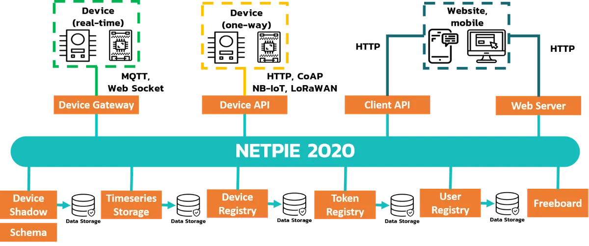

## สร้าง Project ใน NETPIE

1\) เมื่อ login เข้าสู่ https://portal.netpie.io เรียบร้อยแล้ว หน้าจอที่ปรากฏจะแสดงรายการ Project ทั้งหมดที่เคยสร้างไว้แล้ว

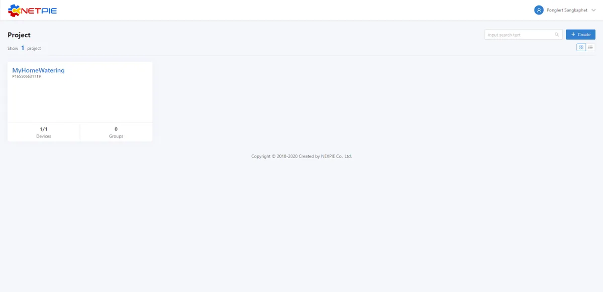

2\) คลิกที่ + Create

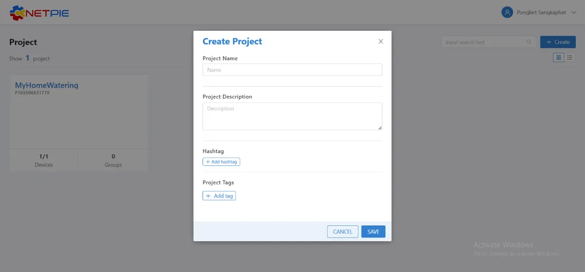

3\) กรอกข้อมูล Project จากนั้นคลิกที่ปุ่ม “SAVE” ระบบจะทำการสร้าง Project ให้

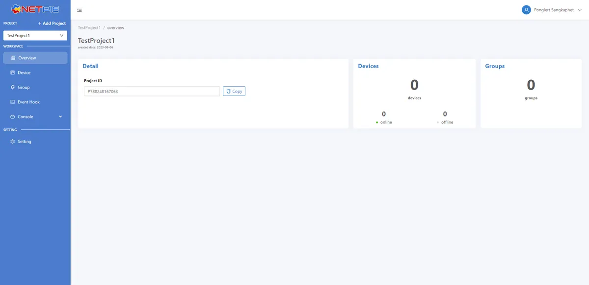

## สร้าง Device

4\) เมื่อเข้ามาในแต่ละ Project แล้วจะปรากฏหน้าจอแสดงข้อมูลภาพรวมของ Project ให้ทำการสร้าง Device โดยคลิกที่เมนู “Device” ทางด้านขวามือ

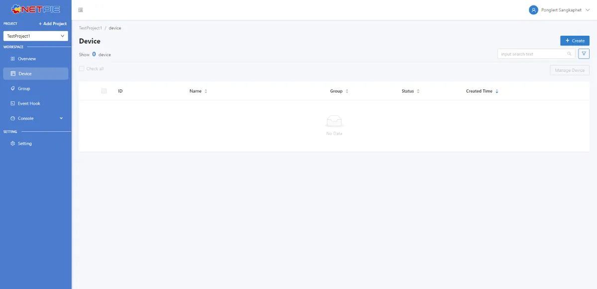

5\) คลิกที่ + Create

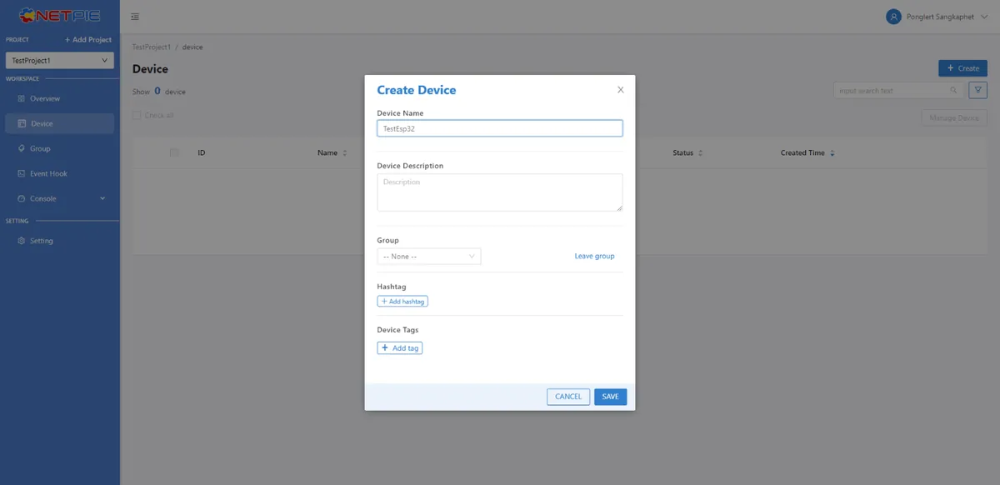

6\) คลิกเข้าไปที่ Device แต่ละรายการจะปรากฏหน้าจอแสดงรายละเอียดข้อมูลต่าง ๆ ของ Device เหล่านั้น รวมถึง Key, Token และ Secret ที่จะนำไปใช้เพื่อให้ Device สามารถเชื่อมต่อเข้ามายัง Platform ได้

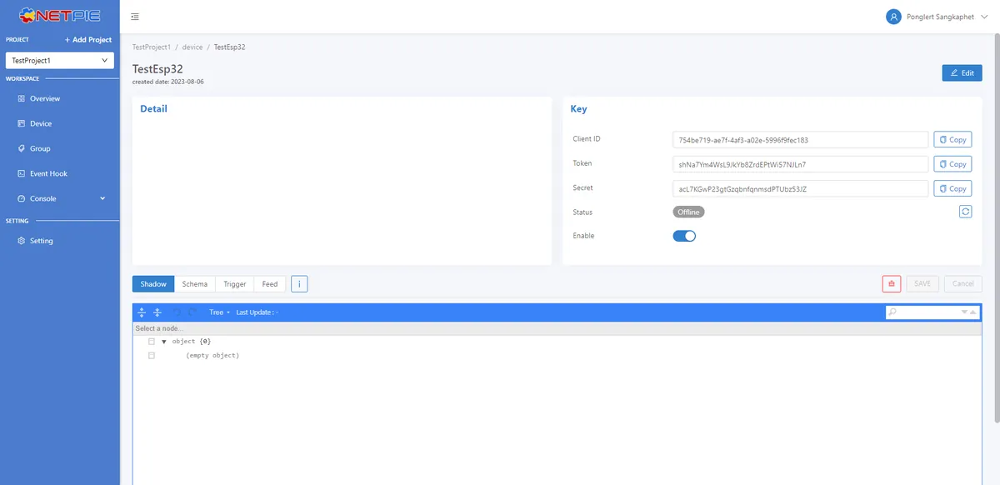

Key ใช้สำหรับการเชื่อมต่อของ Device มายัง Platform จะต้องใช้ 4 Paramters คือ Host, Client id, Username และ Password โดยดูข้อมูลที่จะนำมาใช่ สามารถระบุค่าได้ดังนี้

| **Host**      | broker.netpie.io                      |
|---------------|---------------------------------------|
| **Port**      | 1883                                  |
| **Client ID** | Client ID ของ Device ที่สร้างขึ้นใน NETPIE |
| **Username**  | Token ของ Device ที่สร้างขึ้นใน NETPIE     |
| **Password**  | Secret ของ Device ที่สร้างขึ้นใน NETPIE    |

## เขียนโปรแกรม Project Esp32 เชื่อมต่อ NETPIE เพื่อควบคุม Relay

7\) เปิดโปรแกรม Arduino IDE ให้ติดตั้ง PubSubClient library

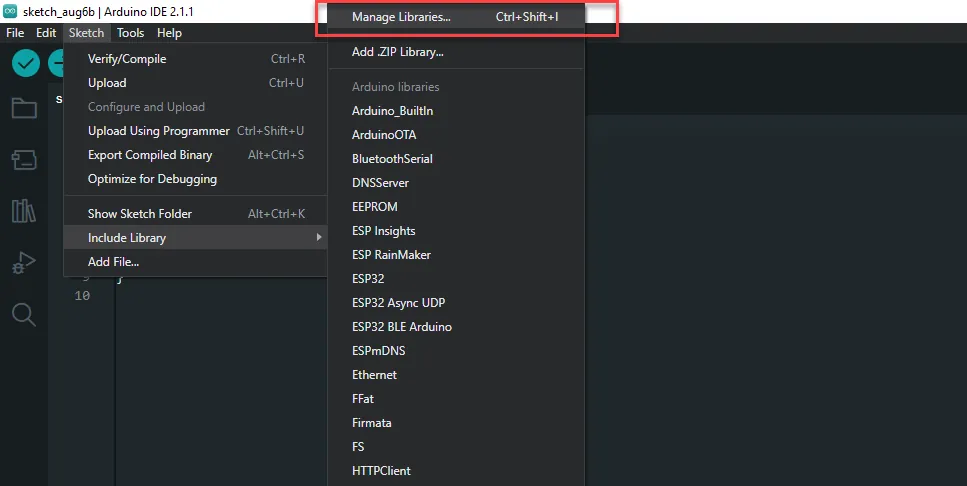

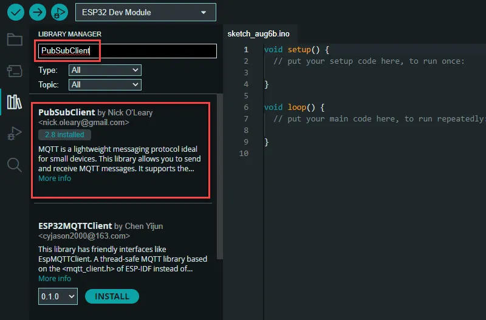

8\) ต่อวงจรระหว่างบอร์ดกับโมดูลรีเลย์

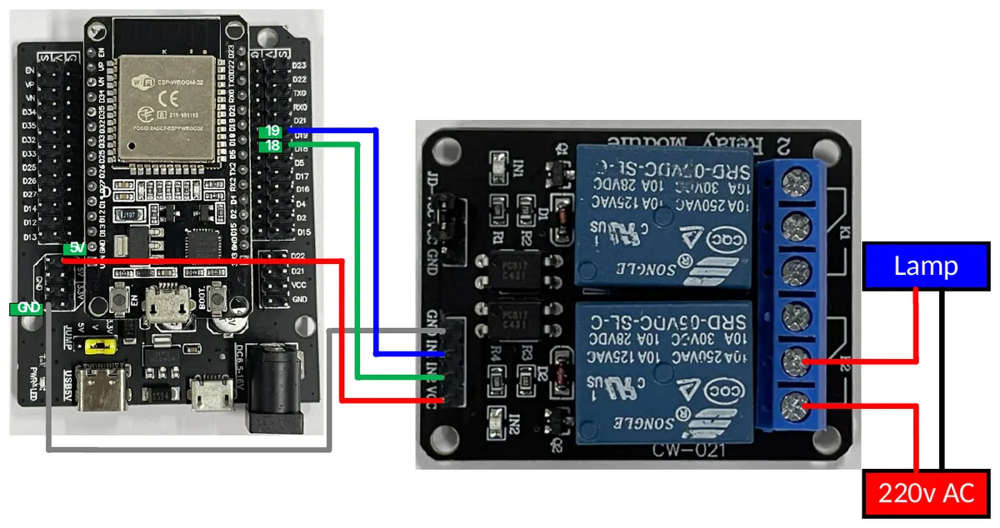

9\) ให้ทำการเขียนโปรแกรมส่วนที่ 1 ดังนี้

```cpp
#include <WiFi.h>
#include <PubSubClient.h>
const char* ssid = "CSUBRUIOT02";  //ชื่อ Wifi
const char* password = "asdf+1234";  //รหัส Wifi
const char* mqtt_server = "broker.netpie.io";
const int mqtt_port = 1883;
const char* mqtt_Client = "73eaf3e2-0efd-48e1-b83e-b26b10d6958c"; //ข้อมูล Client ID
const char* mqtt_username = "zoxYBc53GubFaW8a25DMWmHBmZhGAPpU"; //ข้อมูล Token
const char* mqtt_password = "yvMmhSqvrvpL3yZ4x45NzBxUomGgreER"; //ข้อมูล Secret
WiFiClient espClient;
PubSubClient client(espClient);
char msg[250];
#define relaypin1 19
#define relaypin2 18
int relay1=0;
int relay2=0;
```

10\) ให้ทำการเขียนโปรแกรมส่วนที่ 2 สร้างฟังก์ชัน reconnect ดังนี้

```cpp
void reconnect() {
  while (!client.connected()) {
    Serial.print("Attempting MQTT connection…");
    if (client.connect(mqtt_Client, mqtt_username, mqtt_password)) {
      Serial.println("connected");
      client.subscribe("@msg/#");
    } else {
      Serial.print("failed, rc=");
      Serial.print(client.state());
      delay(5000);
    }
  }
}
```

11\) ให้ทำการเขียนโปรแกรมส่วนที่ 4 สร้างฟังก์ชัน getMsg ดังนี้

```cpp
void getMsg(String topic_, String message_) {
  if (topic_ == "@msg/relay1") {
    if (message_ == "1") {
      relay1 = 1;
    } else if (message_ == "0") {
      relay1 = 0;
    }
    String data = "{\"data\":{\"relay1\": " + String(relay1) + "}}";
    Serial.println(data);
    data.toCharArray(msg , (data.length() + 1));
    client.publish("@shadow/data/update", msg);
  }else if(topic_ == "@msg/relay2"){
     if (message_ == "1") {
      relay2 = 1;
    } else if (message_ == "0") {
      relay2 = 0;
    }
    String data = "{\"data\":{\"relay2\": " + String(relay2) + "}}";
    Serial.println(data);
    data.toCharArray(msg , (data.length() + 1));
    client.publish("@shadow/data/update", msg);
  }
}
```

12\) ให้ทำการเขียนโปรแกรมส่วนที่ 3 สร้างฟังก์ชัน callback ดังนี้

```cpp
void callback(char* topic, byte* payload, unsigned int length) {
  Serial.print("Message arrived [");
  Serial.print(topic);
  Serial.print("] ");
  String message;
  for (int i = 0; i < length; i++) {
    message = message + (char)payload[i];
  }
  Serial.println(message);
  getMsg(topic, message);
}
```

13\) ให้ทำการเขียนโปรแกรมส่วนที่ 4 ในฟังก์ชัน setup ดังนี้

```cpp
void setup() {
  pinMode(relaypin1, OUTPUT);
  pinMode(relaypin2, OUTPUT);
  Serial.begin(9600);
  WiFi.mode(WIFI_STA);
  WiFi.begin(ssid, password);
  while (WiFi.status() != WL_CONNECTED) {
    delay(500);
    Serial.print(".");
  }
  Serial.println("");
  Serial.println("WiFi connected");
  client.setServer(mqtt_server, mqtt_port);
  client.setCallback(callback);
  delay(1000);
 if(!client.connected()) {
    reconnect();
 }
}
```

14\) ให้ทำการเขียนโปรแกรมส่วนที่ 4 ในฟังก์ชัน loop ดังนี้

```cpp
void loop() {
  if (!client.connected()) {
    reconnect();
  }
  if(relay1 == 1){
    if(!digitalRead(relaypin1)){
      digitalWrite(relaypin1, HIGH);
    }
  }else{
    if(digitalRead(relaypin1)){
      digitalWrite(relaypin1, LOW);
    }
  }
  if(relay2 == 1){
    if(!digitalRead(relaypin2)){
      digitalWrite(relaypin2, HIGH);
    }
  }else{
    if(digitalRead(relaypin2)){
      digitalWrite(relaypin2, LOW);
    }
  }
  client.loop();
}
```

## สร้าง Dashboard ควบคุมบน Netpie

15\) คลิกที่เมนู “Dashboard” ในแทบซ้ายมือ ก็จะปรากฏหน้าจอแสดงรายรายชื่อ Dashboard ทั้งหมดที่เคยสร้างไว้ภายใน Project นั้นๆ

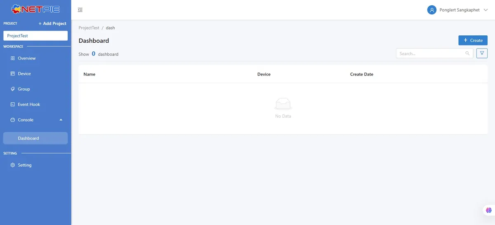

16\) ให้คลิกที่ปุ่ม “Create” มุมบนขวามือของหน้าจอ ก็จะปรากฏหน้าจอสำหรับให้กรอกข้อมูลทั่วไปของ Dashboard

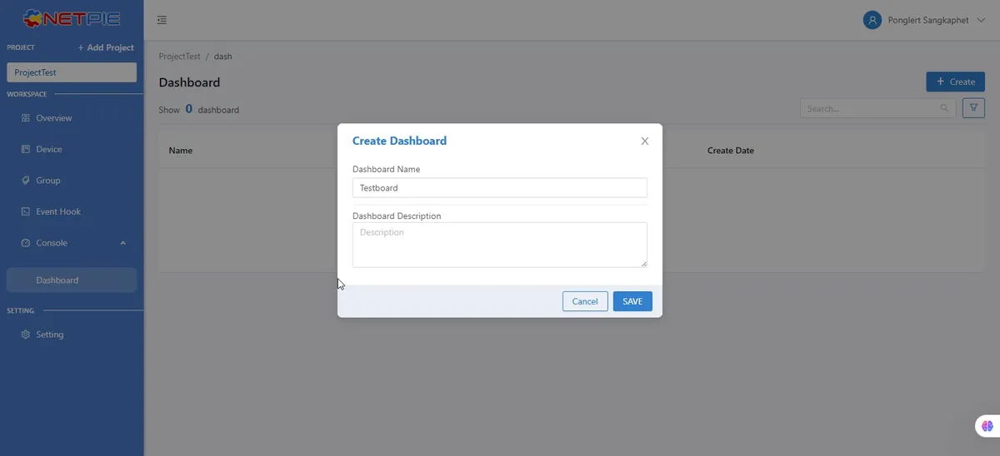

17\) เมื่อกรอกข้อมูลเรียบร้อยแล้วให้คลิกที่ปุ่ม “Create” ก็จะปรากฏรายการ Dashboard ใหม่ที่พึ่งสร้างขึ้นมา

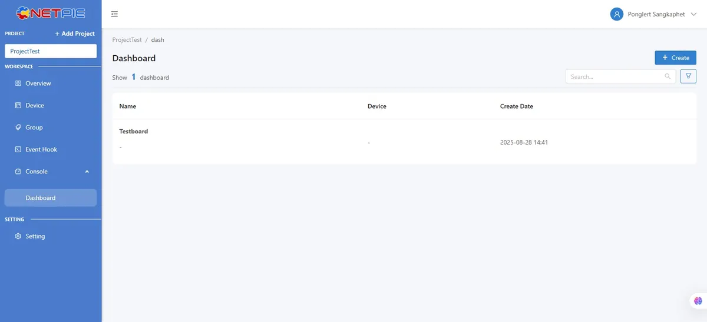

ให้เลือก Dashboard ที่ต้องการ แล้วไปที่ Setting -\> Add source และเลือก Device และ Privileges

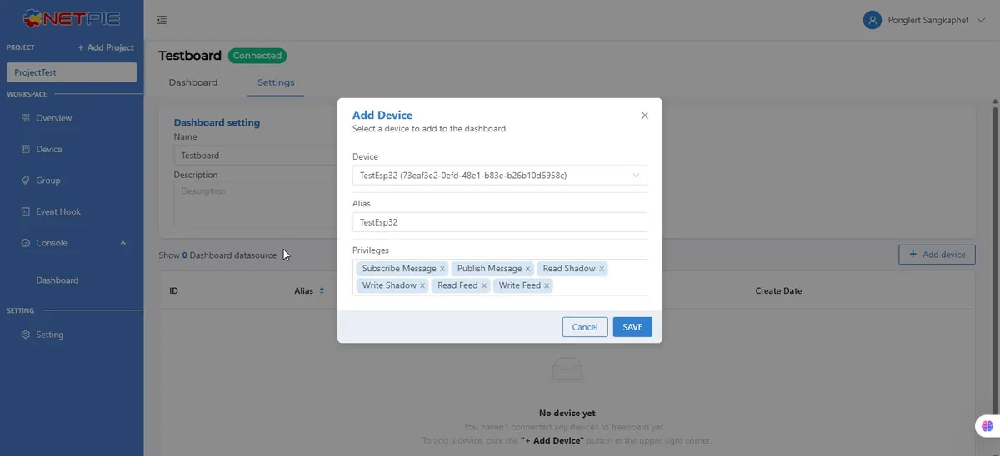

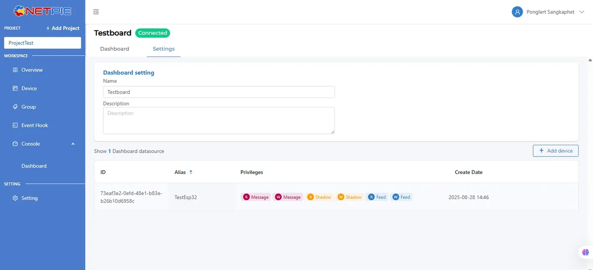

ให้คลิก Edit และ คลิกเพิ่ม Add Panel

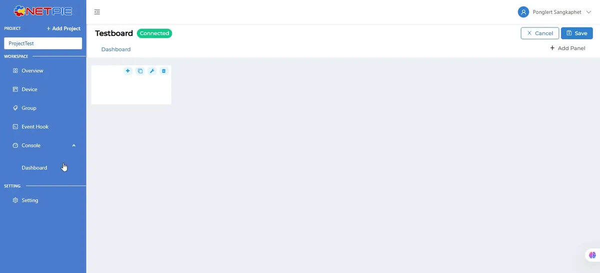

คลิก + ที่ Panel ที่สร้างมา และ เลือกเป็น Toggle

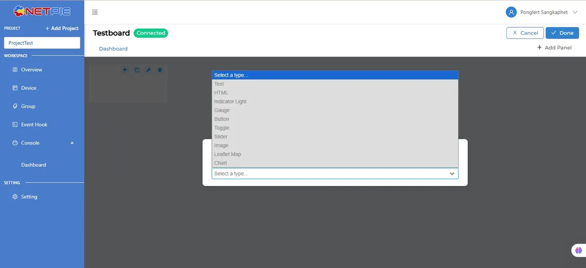

20\) เพิ่ม Toggle สำหรับ Relay 1 และข้อมูลลงไป

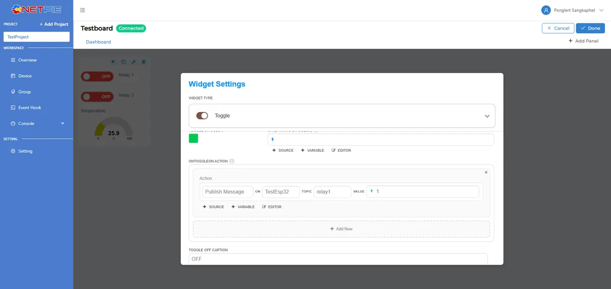

- **LABAL** = Relay 1

- **TOGGLE STATE** = \#\["TestEsp32"\]\["shadow"\]\["relay1"\]==1

- **ONTOGGLEON ACTION** = **Publish Message** ON **TestEsp32** TOPIC **relay1** VALUE **1**

- **ONTOGGLEOFF ACTION** = **Publish Message** ON **TestEsp32** TOPIC **relay1** VALUE **0**

แล้วคลิก Done

21\) เพิ่ม Toggle สำหรับ Relay 2 และข้อมูลลงไป

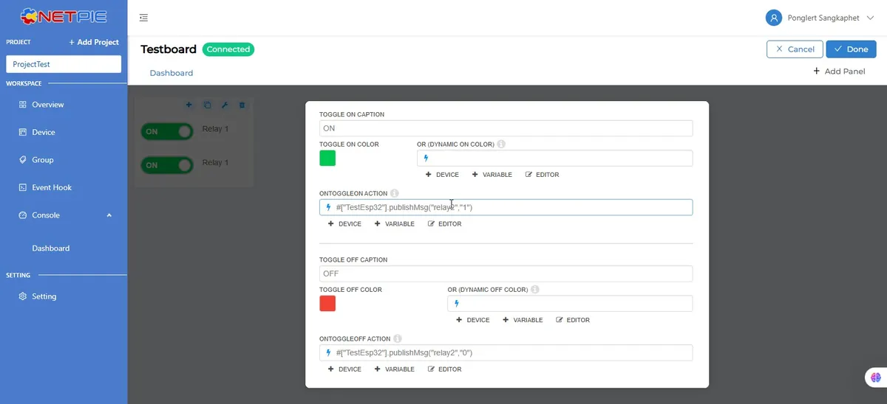

- **LABAL** = Relay 2

- **TOGGLE STATE** = \#\["TestEsp32"\]\["shadow"\]\["relay2"\]==1

- **ONTOGGLEON ACTION** = **Publish Message** ON **TestEsp32** TOPIC **relay2** VALUE **1**

- **ONTOGGLEOFF ACTION** = **Publish Message** ON **TestEsp32** TOPIC **relay2** VALUE **0**

แล้วคลิก Done

Dashboard จะแสดง TOGGLE ที่จะใช้สั่งเปิด Relay ขึ้นมา 2 ตัว

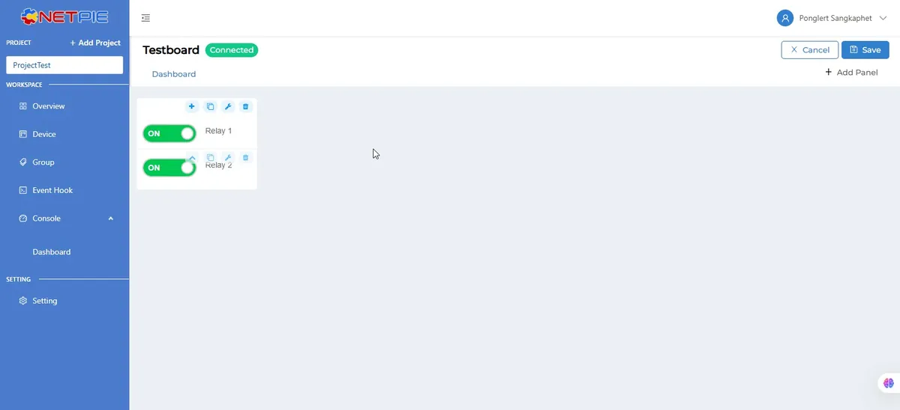

22\) ให้กดปุ่ม “SAVE”

## การส่งค่าเซนเซอร์ข้อมูลไปแสดงผลบน NETPIE

1\) ต่อวงจรระหว่างบอร์ดกับโมดูล DHT11


2\) ให้ทำการเขียนโปรแกรมส่วนที่ 1 ดังนี้

```cpp
#include <WiFi.h>
#include <PubSubClient.h>
const char* ssid = "CSUBRUIOT02";  //ชื่อ Wifi
const char* password = "asdf+1234";  //รหัส Wifi
const char* mqtt_server = "broker.netpie.io";
const int mqtt_port = 1883;
const char* mqtt_Client = "73eaf3e2-0efd-48e1-b83e-b26b10d6958c"; //ข้อมูล Client ID
const char* mqtt_username = "zoxYBc53GubFaW8a25DMWmHBmZhGAPpU"; //ข้อมูล Token
const char* mqtt_password = "yvMmhSqvrvpL3yZ4x45NzBxUomGgreER"; //ข้อมูล Secret
WiFiClient espClient;
PubSubClient client(espClient);
char msg[250];
#define relaypin1 19
#define relaypin2 18
int relay1=0;
int relay2=0;
#include "DHT.h"
#define DHTPIN 5
#define DHTTYPE DHT11
DHT dht(DHTPIN, DHTTYPE);
unsigned long previousTime = 0;
```

3\) ให้ทำการเขียนโปรแกรมเพิ่มฟังก์ชัน setup

```cpp
void setup() {
  pinMode(relaypin1, OUTPUT);
  pinMode(relaypin2, OUTPUT);
  dht.begin();
  Serial.begin(9600);
  WiFi.mode(WIFI_STA);
  WiFi.begin(ssid, password);
  while (WiFi.status() != WL_CONNECTED) {
    delay(500);
    Serial.print(".");
  }
  Serial.println("");
  Serial.println("WiFi connected");
  client.setServer(mqtt_server, mqtt_port);
  client.setCallback(callback);
  delay(1000);
 if(!client.connected()) {
    reconnect();
 }
}
```

4\) ให้ทำการเขียนโปรแกรมเพิ่มฟังก์ชันการส่งข้อมูลไป NETPIE

```cpp
void setMsgTemp(String temp){
  String data = "{\"data\":{\"temp\": " + temp + "}}";
  Serial.println(data);
  data.toCharArray(msg , (data.length() + 1));
  client.publish("@shadow/data/update", msg);
}
```

5\) ให้ทำการเขียนโปรแกรมเพิ่มฟังก์ชันใน loop

```cpp
void loop() {
  if (!client.connected()) {
    reconnect();
  }
  if(relay1 == 1){
    if(!digitalRead(relaypin1)){
      digitalWrite(relaypin1, HIGH);
    }
  }else{
    if(digitalRead(relaypin1)){
      digitalWrite(relaypin1, LOW);
    }
  }
  if(relay2 == 1){
    if(!digitalRead(relaypin2)){
      digitalWrite(relaypin2, HIGH);
    }
  }else{
    if(digitalRead(relaypin2)){
      digitalWrite(relaypin2, LOW);
    }
  }
  if((millis() - previousTime) >= 2000){
    previousTime = millis();
    float h = dht.readHumidity();
    float t = dht.readTemperature();
    if (isnan(h) || isnan(t)) {
      Serial.println(F("Failed to read from DHT sensor!"));
    }else{
      setMsgTemp(String(t));
      Serial.print(F("Humidity: "));
      Serial.print(h);
      Serial.print(F("%  Temperature: "));
      Serial.print(t);
      Serial.println(F("°C "));
    }
  }
  client.loop();
}
```

6\) ให้ทำการเพิ่ม gauge ใน Dashboard ดังรูป

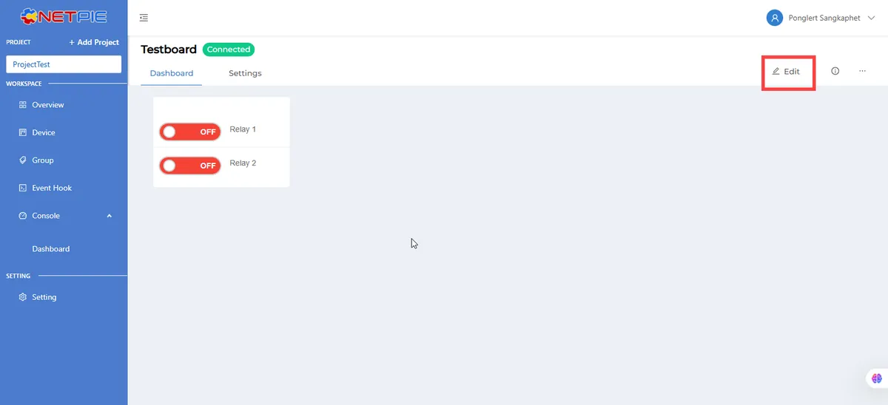

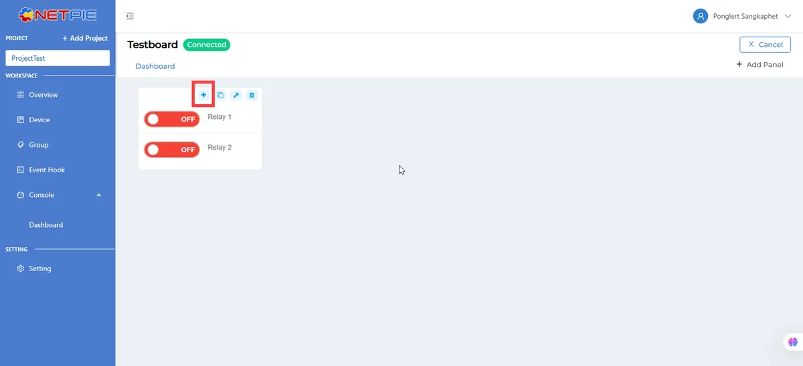

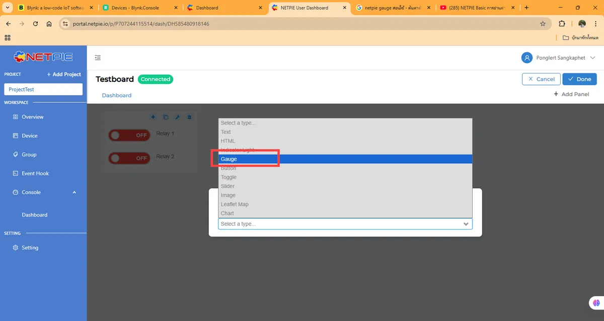

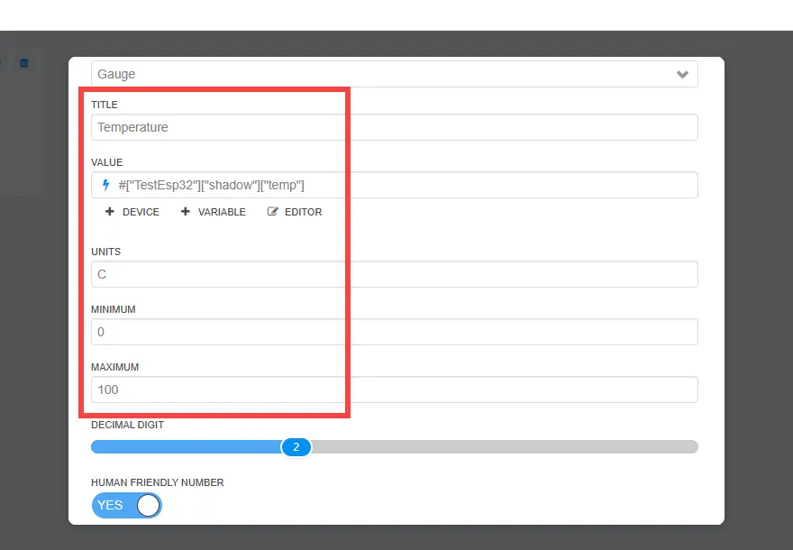

- **TITLE** = Temperature

- **VALUE** = \#\["TestEsp32"\]\["shadow"\]\["temp"\]

- **UNITS** = C

- **MINIMUM** = 0

แล้วคลิก Done

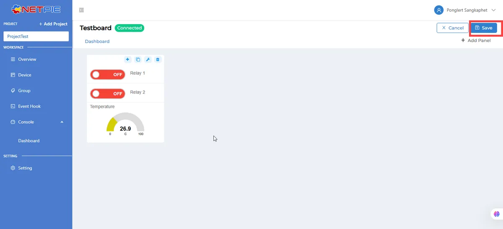

## แบบฝึกหัด

ทำการแสดงค่า**ความชื้นในอากาศจากเซนเซอร์**บน NETPIE แสดงที่เว็บ Dashboard โดยให้ทำการเขียนโปรแกรมเพิ่มจากโค้ดก่อนหน้านี้ และตั้งค่าต่าง ๆ เพิ่มในแพลตฟอร์ม NETPIE ให้ได้ผลลัพธ์ดังรูป

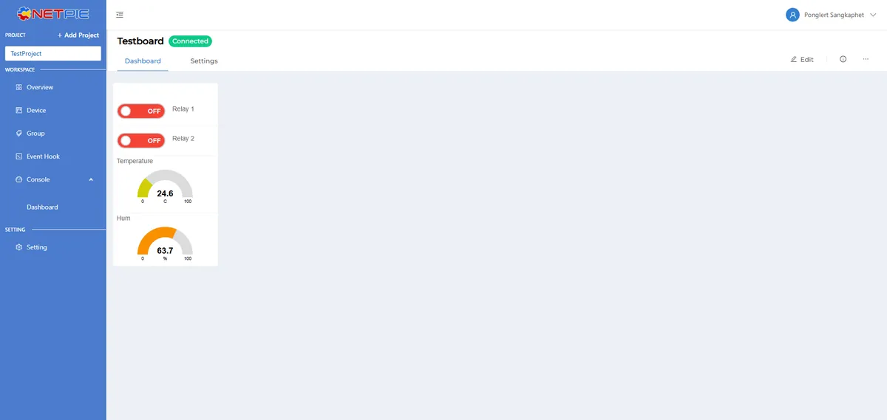
