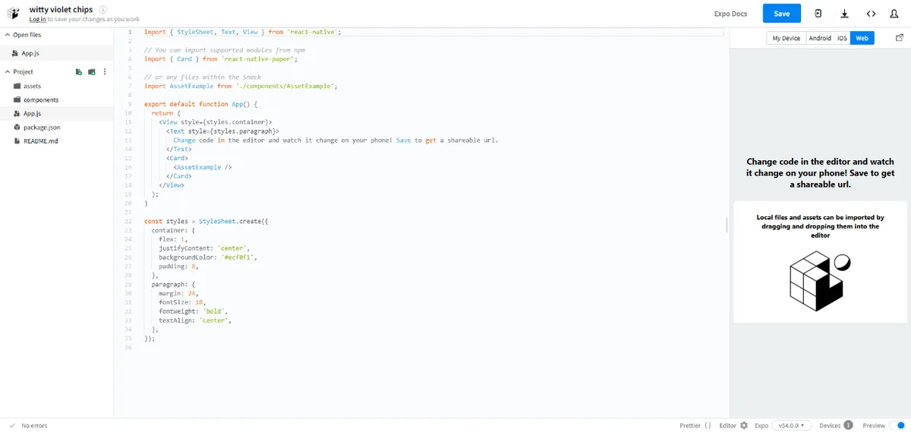
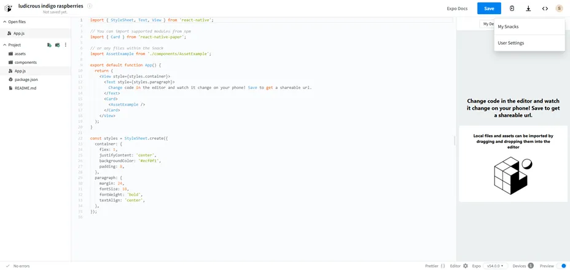
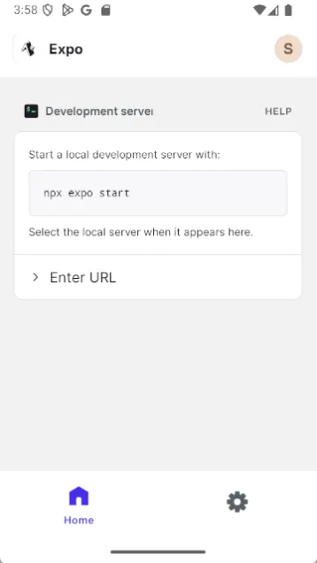
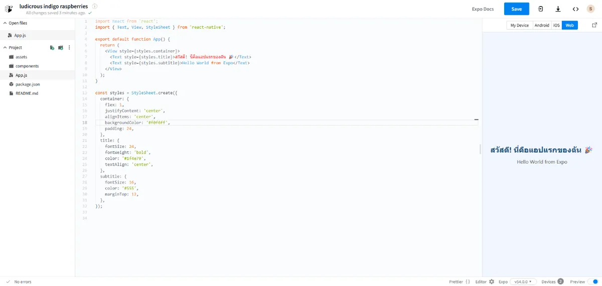
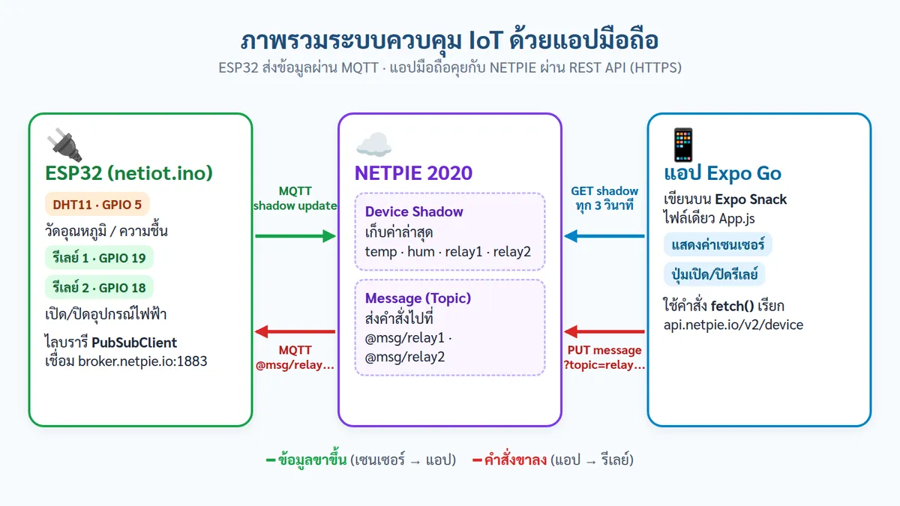
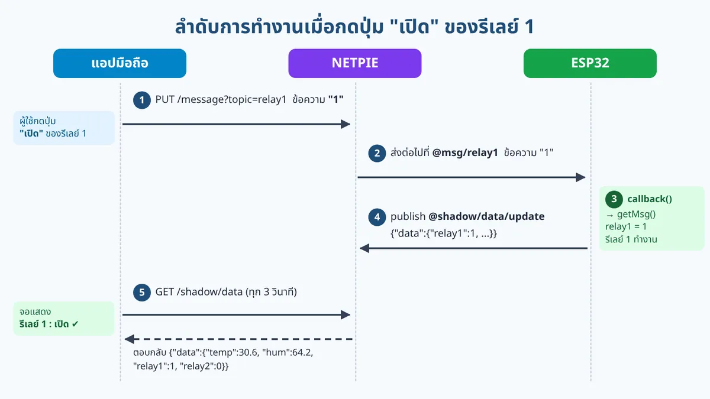
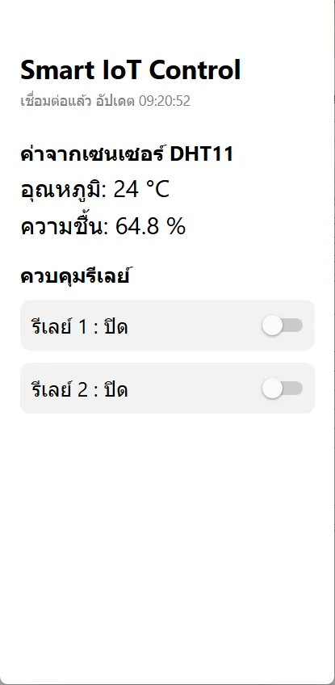

# ตอนที่ 8: การพัฒนาแอปพลิเคชันบนมือถือควบคุมอุปกรณ์ IoT

React Native คือเทคโนโลยีสำหรับสร้างแอปมือถือ (ทั้ง Android และ iOS) โดยเขียนด้วยภาษา JavaScript ทำให้เขียนครั้งเดียวใช้ได้ทั้งสองระบบ

Expo คือชุดเครื่องมือที่ช่วยให้การเริ่มต้นเขียน React Native ง่ายขึ้นมาก ไม่ต้องตั้งค่ายุ่งยาก

Expo Snack คือเว็บไซต์ (snack.expo.dev) สำหรับเขียนโค้ดแอปได้จากในเบราว์เซอร์โดยตรง ไม่ต้องติดตั้งอะไรบนเครื่อง เหมาะกับการเรียนรู้และทดลอง

Expo Go คือแอปบนมือถือที่ใช้ "เปิดดู" โปรเจกต์ที่เราเขียนไว้บน Snack แบบเรียลไทม์ พอแก้โค้ดบนเว็บ หน้าจอในมือถือก็อัปเดตตามทันที

## ขั้นตอนที่ 1: สมัครใช้งาน Expo Snack

1\. เปิดเว็บเบราว์เซอร์บนคอมพิวเตอร์ แล้วพิมพ์ที่อยู่ snack.expo.dev



2\. เมื่อหน้าเว็บโหลดเสร็จ ให้มองมุมขวาบน จะเห็นปุ่ม "Sign Up" (สมัครสมาชิก) หรือ "Log In" คลิกที่ "Sign Up"

3\. เลือกวิธีสมัครที่สะดวก: กรอกอีเมลและตั้งรหัสผ่านเอง หรือกดปุ่ม "Continue with Google" / "Continue with GitHub" เพื่อใช้บัญชีที่มีอยู่แล้ว

4\. หากสมัครด้วยอีเมล ให้เปิดกล่องอีเมลของคุณ ค้นหาเมลยืนยันจาก Expo แล้วคลิกลิงก์ยืนยัน (บางครั้งอาจอยู่ในโฟลเดอร์ Junk/Spam)

5\. เมื่อเข้าสู่ระบบสำเร็จ จะเห็นชื่อบัญชี/รูปโปรไฟล์ที่มุมขวาบน ถือว่าสมัครและล็อกอินเรียบร้อย



## ขั้นตอนที่ 2: ติดตั้งแอป Expo Go บนมือถือ

### สำหรับ Android

1\. เปิดแอป "Play Store" (Google Play) บนโทรศัพท์

2\. แตะช่องค้นหาด้านบน พิมพ์คำว่า Expo Go

3\. เลือกแอปชื่อ "Expo Go" (ผู้พัฒนาคือ Expo) แล้วกดปุ่ม "ติดตั้ง" (Install)

4\. รอจนติดตั้งเสร็จ แล้วเปิดแอปขึ้นมา



### สำหรับ iPhone (iOS)

1\. เปิดแอป "App Store" บน iPhone

2\. แตะแท็บ "ค้นหา" (Search) ด้านล่างขวา แล้วพิมพ์ Expo Go

3\. เลือกแอป "Expo Go" แล้วกดปุ่มดาวน์โหลด (รูปเมฆ หรือ Get) อาจต้องยืนยันด้วย Face ID / Touch ID / รหัสผ่าน Apple ID

4\. รอจนติดตั้งเสร็จ แล้วเปิดแอปขึ้นมา

## ขั้นตอนที่ 3: สร้างโปรเจกต์และเขียนข้อความแรก

1\. กลับมาที่เว็บ snack.expo.dev บนคอมพิวเตอร์ (ล็อกอินอยู่)

2\. ระบบจะสร้างโปรเจกต์ตัวอย่างให้อัตโนมัติ มองด้านซ้ายจะเห็นรายการไฟล์ ให้คลิกไฟล์ชื่อ App.js

3\. ในกรอบเขียนโค้ดตรงกลาง ให้ลบโค้ดเดิมทั้งหมดออก แล้วพิมพ์ (หรือคัดลอก) โค้ดด้านล่างนี้แทน:

```javascript
import React from 'react';
import { Text, View, StyleSheet } from 'react-native';

export default function App() {
  return (
    <View style={styles.container}>
      <Text style={styles.title}>สวัสดี! นี่คือแอปแรกของฉัน 🎉</Text>
      <Text style={styles.subtitle}>Hello World from Expo</Text>
    </View>
  );
}

const styles = StyleSheet.create({
  container: {
    flex: 1,
    justifyContent: 'center',
    alignItems: 'center',
    backgroundColor: '#f0f6ff',
    padding: 24,
  },
  title: {
    fontSize: 24,
    fontWeight: 'bold',
    color: '#1f4e79',
    textAlign: 'center',
  },
  subtitle: {
    fontSize: 16,
    color: '#555',
    marginTop: 12,
  },
});
```

\*Snack จะบันทึกและประมวลผลโค้ดให้อัตโนมัติ ไม่ต้องกดปุ่ม Save เอง



## ขั้นตอนที่ 4: แสดงผลบนโทรศัพท์ของคุณ

ตอนนี้ถึงเวลานำโค้ดขึ้นไปแสดงบนมือถือจริง ทำได้ด้วยการสแกน QR Code:

1\. บนเว็บ Snack มองด้านขวา จะมีแท็บ/ปุ่มชื่อ "My Device" หรือ "Run" ให้คลิกเพื่อแสดง QR Code

2\. เปิดแอป Expo Go บนมือถือ

3\. Android: ในแอป Expo Go จะมีเมนู "Scan QR code" ให้แตะ แล้วเล็งกล้องไปที่ QR บนหน้าจอคอมพิวเตอร์

4\. iPhone: เปิดแอปกล้อง (Camera) ปกติของเครื่อง เล็งไปที่ QR แล้วแตะแถบแจ้งเตือนที่เด้งขึ้นมาเพื่อเปิดใน Expo Go

5\. รอสักครู่ให้โหลดโปรเจกต์ จากนั้นหน้าจอมือถือจะแสดงข้อความ "สวัสดี! นี่คือแอปแรกของฉัน" ยินดีด้วย — คุณแสดงผลข้อความแรกบนมือถือสำเร็จแล้ว!


## ขั้นตอนที่ 5: ทำความเข้าใจภาพรวมระบบควบคุม IoT

ขั้นตอนนี้เราจะสร้างแอป "Smart IoT Control" สำหรับควบคุมบอร์ด ESP32 (โค้ด netiot) ที่ต่อเซนเซอร์ DHT11 วัดอุณหภูมิและความชื้น กับรีเลย์ 2 ช่อง โดยมีแพลตฟอร์ม NETPIE 2020 เป็น "ตัวกลาง" รับส่งข้อมูลระหว่างบอร์ดกับมือถือ ก่อนเขียนโค้ด มาดูภาพรวมของระบบกันก่อน



ระบบมี 3 ส่วน ทำงานร่วมกันดังนี้

1\. ESP32 อ่านค่าเซนเซอร์ทุก 2 วินาที แล้วส่งขึ้นไปเก็บที่ Device Shadow ของ NETPIE และคอยรับคำสั่งเปิด/ปิดรีเลย์จาก Topic @msg/relay1 และ @msg/relay2

2\. NETPIE ทำหน้าที่เหมือน "กล่องฝากข้อมูล" เก็บค่าล่าสุดไว้ใน Shadow และส่งต่อคำสั่งจากแอปไปให้ ESP32

3\. แอปมือถือ ใช้คำสั่ง fetch() ติดต่อ NETPIE ผ่านอินเทอร์เน็ต (REST API) ทำงานเพียง 2 อย่าง คือ อ่านค่าจาก Shadow และส่งคำสั่ง โดยไม่ต้องติดตั้งไลบรารีเพิ่มใน Expo Snack

**ตารางช่องทางการรับส่งข้อมูลในระบบ**

| ทิศทาง                | วิธี             | ปลายทาง (Topic / URL)                        | ข้อมูลที่ส่ง                                                    |
|----------------------|----------------|----------------------------------------------|------------------------------------------------------------|
| ESP32 → NETPIE       | MQTT publish   | @shadow/data/update                          | {"data":{"temp":30.6, "hum":64.2, "relay1":0, "relay2":1}} |
| NETPIE → ESP32       | MQTT subscribe | @msg/relay1, @msg/relay2                     | "1" = เปิด, "0" = ปิด                                        |
| แอป → NETPIE (อ่านค่า) | HTTP GET       | api.netpie.io/v2/device/shadow/data          | ได้ JSON ค่าล่าสุดกลับมา                                        |
| แอป → NETPIE (สั่งงาน) | HTTP PUT       | api.netpie.io/v2/device/message?topic=relay1 | ข้อความ "1" หรือ "0"                                         |

ทุกครั้งที่แอปติดต่อ NETPIE ต้องแนบ "บัตรผ่าน" ไปด้วย คือส่วนหัว (Header) ชื่อ Authorization ในรูปแบบ Device ClientID:Token โดยใช้ Client ID และ Token ของ Device เดียวกับที่ใส่ในโค้ด ESP32 และเมื่อส่งคำสั่งผ่าน REST ให้ใช้ชื่อ Topic เฉย ๆ เช่น relay1 ไม่ต้องใส่ @msg/ นำหน้า



เมื่อผู้ใช้กดปุ่ม "เปิด" ของรีเลย์ 1 จะเกิดการทำงานตามลำดับดังภาพ คือ (1) แอปส่งคำสั่ง "1" ไปที่ NETPIE (2) NETPIE ส่งต่อให้ ESP32 (3) ESP32 สั่งรีเลย์ทำงาน (4) ESP32 รายงานสถานะใหม่ขึ้น Shadow และ (5) แอปอ่าน Shadow ในรอบถัดไป แล้วแสดงคำว่า "เปิด" บนจอ ดังนั้นข้อความบนจอจะเปลี่ยนหลังกดปุ่มประมาณ 2–3 วินาที ซึ่งเป็นเรื่องปกติ และยังช่วยยืนยันว่ารีเลย์ทำงานจริง

## ขั้นตอนที่ 6: สร้างแอปควบคุม IoT บน Expo Snack

1\. เข้าเว็บ snack.expo.dev แล้วสร้าง Snack ใหม่ ตั้งชื่อโปรเจกต์ว่า Smart IoT Control

2\. คลิกไฟล์ App.js ลบโค้ดเดิมทั้งหมด แล้ววางโค้ดด้านล่างนี้แทน

3\. แก้บรรทัด CLIENT_ID และ TOKEN ให้เป็นค่าของ Device เดียวกับที่ใส่ใน ESP32 (ใช้ Token ไม่ใช่ Secret)

โค้ดใน App.js แบ่งออกเป็นส่วนนำเข้าคำสั่ง และอีก 7 ส่วนตามหมายเหตุ (comment) ที่ขึ้นต้นด้วย // ---------- ส่วนที่ ... แต่ละส่วนมีหน้าที่ดังนี้

### ส่วนนำเข้าคำสั่ง (import)

```javascript
import React, { useState, useEffect, useRef } from 'react';
import { View, Text, Switch, StyleSheet } from 'react-native';
```

- บรรทัดแรกนำเข้า React และ Hook 3 ตัว คือ useState (เก็บค่าที่แสดงบนจอ) useEffect (สั่งให้ทำงานเมื่อเปิดแอป) และ useRef (จำค่าไว้ใช้ภายในโดยไม่ต้องวาดจอใหม่)

- บรรทัดที่สองนำเข้าชิ้นส่วนหน้าจอ ได้แก่ View (กล่องจัดวาง) Text (ข้อความ) Switch (สวิตช์เปิด/ปิด) และ StyleSheet (กำหนดขนาดและสี)

- Switch เป็นชิ้นส่วนมาตรฐานของ React Native จึงใช้ได้ทันทีใน Expo Snack ไม่ต้องติดตั้งไลบรารีเพิ่ม

### ส่วนที่ 1: ตั้งค่าการเชื่อมต่อ NETPIE

```javascript
const CLIENT_ID = 'ใส่ Client ID ของอุปกรณ์';
const TOKEN = 'ใส่ Token ของอุปกรณ์';
const AUTH = 'Device ' + CLIENT_ID + ':' + TOKEN;
const API_URL = 'https://api.netpie.io/v2/device';
```

- CLIENT_ID และ TOKEN คือ "บัตรผ่าน" ของ Device ต้องเป็นค่าเดียวกับที่ใส่ในโค้ด ESP32

- AUTH ต่อข้อความด้วยเครื่องหมาย + ให้ได้รูปแบบ Device ClientID:Token ซึ่งต้องแนบไปใน Header ทุกครั้งที่ติดต่อ NETPIE

- API_URL คือที่อยู่หลักของ NETPIE REST API เวลาใช้งานจะต่อท้ายด้วย /shadow/data (อ่านค่า) หรือ /message (ส่งคำสั่ง)

- ประกาศไว้นอกฟังก์ชัน App ด้วย const เพราะเป็นค่าคงที่ ไม่เปลี่ยนระหว่างใช้งาน

### ส่วนที่ 2: ตัวแปรเก็บค่าที่แสดงบนหน้าจอ

```javascript
const [temp, setTemp] = useState('-');
const [hum, setHum] = useState('-');
const [relay1, setRelay1] = useState(0);
const [relay2, setRelay2] = useState(0);
const [status, setStatus] = useState('กำลังเชื่อมต่อ...');
const lastCommand = useRef(0); // เวลาที่เลื่อนสวิตช์ครั้งล่าสุด
```

- useState สร้างตัวแปรเป็นคู่ \[ค่า, ฟังก์ชันเปลี่ยนค่า\] เช่น \[temp, setTemp\] เมื่อเรียก setTemp() หน้าจอจะแสดงค่าใหม่ให้อัตโนมัติ

- temp และ hum เริ่มต้นเป็น '-' (ยังไม่มีข้อมูล) ส่วน relay1 และ relay2 เริ่มต้นเป็น 0 หมายถึงปิด และ status ใช้เก็บข้อความแจ้งสถานการณ์เชื่อมต่อ

- lastCommand สร้างด้วย useRef ใช้จำ "เวลาที่เลื่อนสวิตช์ครั้งล่าสุด" ต่างจาก useState ตรงที่เปลี่ยนค่าแล้วหน้าจอไม่วาดใหม่ เหมาะกับค่าที่ใช้ภายใน โดยอ่านและเขียนค่าผ่าน lastCommand.current

### ส่วนที่ 3: อ่านค่าล่าสุดจาก Device Shadow

```javascript
const loadData = async () => {
  try {
    const res = await fetch(API_URL + '/shadow/data', {
      headers: { Authorization: AUTH },
    });
    if (!res.ok) {
      setStatus('เชื่อมต่อไม่ได้ (ตรวจสอบ Client ID / Token)');
      return;
    }
    const json = await res.json();
    const data = json.data || {}; // ถ้ายังไม่มีข้อมูล ให้ใช้ค่าว่าง {}
    setTemp(data.temp);
    setHum(data.hum);
    // หลังเลื่อนสวิตช์ 5 วินาทีแรก ยังไม่ใช้สถานะรีเลย์จาก Shadow
    // (รอให้ ESP32 รายงานสถานะใหม่ก่อน สวิตช์จะได้ไม่เด้งกลับ)
    if (Date.now() - lastCommand.current > 5000) {
      setRelay1(data.relay1);
      setRelay2(data.relay2);
    }
    setStatus('เชื่อมต่อแล้ว อัปเดต ' + new Date().toLocaleTimeString());
  } catch (error) {
    setStatus('เชื่อมต่อไม่ได้ (ตรวจสอบอินเทอร์เน็ต)');
  }
};
```

- async / await ทำให้โค้ด "รอ" ผลจาก fetch() ให้เสร็จก่อน แล้วจึงทำบรรทัดถัดไป

- fetch() แบบ GET (ค่าเริ่มต้น) ไปที่ /shadow/data พร้อมแนบ Authorization ถ้า res.ok เป็นเท็จ แสดงว่า Client ID หรือ Token ไม่ถูกต้อง แอปจะแจ้งบนจอแล้วหยุดด้วย return

- res.json() แปลงผลลัพธ์เป็นข้อมูล JSON ค่าที่ ESP32 ส่งขึ้นมาอยู่ใน json.data จากนั้นนำไปใส่ setTemp() และ setHum()

- เงื่อนไข Date.now() - lastCommand.current \> 5000 ใช้กันสวิตช์ "เด้งกลับ" เพราะช่วงไม่กี่วินาทีหลังเลื่อนสวิตช์ Shadow ยังเก็บสถานะเก่าอยู่ แอปจึงงดอ่านสถานะรีเลย์ 5 วินาที แต่ยังอ่านอุณหภูมิและความชื้นตามปกติ

- try / catch ดักกรณีไม่มีอินเทอร์เน็ต แอปจะแสดงข้อความเตือนแทนการค้าง

### ส่วนที่ 4: อ่านค่าซ้ำอัตโนมัติทุก 3 วินาที

```javascript
useEffect(() => {
  loadData(); // อ่านครั้งแรกทันทีที่เปิดแอป
  const timer = setInterval(loadData, 3000); // อ่านซ้ำทุก 3000 มิลลิวินาที
  return () => clearInterval(timer); // หยุดตั้งเวลาเมื่อปิดแอป
}, []);
```

- useEffect ที่มี \[\] ต่อท้าย จะทำงานเพียงครั้งเดียวตอนเปิดแอป

- loadData() บรรทัดแรกอ่านค่าทันที ส่วน setInterval สั่งให้ loadData ทำงานซ้ำทุก 3000 มิลลิวินาที (3 วินาที)

- return () =\> clearInterval(timer) หยุดการตั้งเวลาเมื่อปิดหน้าจอ ไม่ให้ทำงานค้างอยู่เบื้องหลัง

### ส่วนที่ 5: สั่งเปิด/ปิดรีเลย์เมื่อเลื่อนสวิตช์

```javascript
const toggleRelay = async (topic, isOn) => {
  const value = isOn ? 1 : 0;
  if (topic === 'relay1') setRelay1(value); // เลื่อนสวิตช์บนจอทันที
  if (topic === 'relay2') setRelay2(value);
  lastCommand.current = Date.now(); // จำเวลาที่สั่งงาน
  try {
    const res = await fetch(API_URL + '/message?topic=' + topic, {
      method: 'PUT',
      headers: { Authorization: AUTH },
      body: String(value), // ส่งข้อความ '1' หรือ '0'
    });
    if (res.ok) {
      setStatus('ส่งคำสั่ง ' + topic + ' = ' + value + ' แล้ว');
    } else {
      lastCommand.current = 0; // ส่งไม่สำเร็จ ให้กลับไปใช้ค่าจาก Shadow
      setStatus('ส่งคำสั่งไม่สำเร็จ');
    }
  } catch (error) {
    lastCommand.current = 0;
    setStatus('ส่งคำสั่งไม่สำเร็จ (ตรวจสอบอินเทอร์เน็ต)');
  }
};
```

- toggleRelay ถูกเรียกทุกครั้งที่ผู้ใช้เลื่อนสวิตช์ รับค่า topic ('relay1' หรือ 'relay2') และ isOn (true = เปิด, false = ปิด) ที่ Switch ส่งมาให้

- isOn ? 1 : 0 แปลง true/false เป็นตัวเลข 1/0 ให้ตรงกับที่ ESP32 รอรับ

- setRelay1(value) หรือ setRelay2(value) เปลี่ยนสถานะบนจอทันที ผู้ใช้จึงเห็นสวิตช์เลื่อนโดยไม่ต้องรอ และบันทึกเวลาไว้ใน lastCommand.current เพื่อใช้ในส่วนที่ 3

- fetch() แบบ PUT ไปที่ /message?topic=relay1 โดยใช้ชื่อ Topic เฉย ๆ ไม่ต้องใส่ @msg/ นำหน้า ส่วน body เป็นข้อความ '1' หรือ '0' จึงแปลงตัวเลขด้วย String(value)

- ถ้าส่งคำสั่งไม่สำเร็จ จะตั้ง lastCommand.current = 0 เพื่อให้ loadData รอบถัดไปดึงสถานะจริงจาก Shadow สวิตช์บนจอจะกลับไปตรงกับรีเลย์จริง

### ส่วนที่ 6: ส่วนแสดงผลบนหน้าจอ

```javascript
return (
    <View style={styles.container}>
      <Text style={styles.title}>Smart IoT Control</Text>
      <Text style={styles.status}>{status}</Text>
      <Text style={styles.header}>ค่าจากเซนเซอร์ DHT11</Text>
      <Text style={styles.value}>อุณหภูมิ: {temp} °C</Text>
      <Text style={styles.value}>ความชื้น: {hum} %</Text>
      <Text style={styles.header}>ควบคุมรีเลย์</Text>
      <View style={styles.row}>
        <Text style={styles.label}>รีเลย์ 1 : {relay1 == 1 ? 'เปิด' : 'ปิด'}</Text>
        <Switch
          value={relay1 == 1}
          onValueChange={(isOn) => toggleRelay('relay1', isOn)}
          trackColor={{ false: '#cccccc', true: '#4caf50' }}
        />
      </View>
      <View style={styles.row}>
        <Text style={styles.label}>รีเลย์ 2 : {relay2 == 1 ? 'เปิด' : 'ปิด'}</Text>
        <Switch
          value={relay2 == 1}
          onValueChange={(isOn) => toggleRelay('relay2', isOn)}
          trackColor={{ false: '#cccccc', true: '#4caf50' }}
        />
      </View>
    </View>
);
```

- โค้ดที่อยู่ใน return เขียนแบบ JSX ใช้บอกว่าหน้าจอมีอะไรบ้าง ส่วน {status} {temp} {hum} คือการแทรกค่าตัวแปรลงในข้อความ

- รีเลย์แต่ละช่องอยู่ใน \<View style={styles.row}\> แถวเดียวกัน ด้านซ้ายเป็นข้อความสถานะ "เปิด/ปิด" ด้านขวาเป็นสวิตช์

- value={relay1 == 1} กำหนดตำแหน่งสวิตช์ Switch ต้องการค่า true/false จึงเปรียบเทียบกับ 1 ก่อน (ใช้ == เพื่อรองรับทั้งตัวเลข 1 และข้อความ "1")

- onValueChange จะทำงานเมื่อผู้ใช้เลื่อนสวิตช์ และส่งค่าใหม่ (isOn) ต่อให้ toggleRelay()

- trackColor กำหนดสีรางสวิตช์ ตอนปิดเป็นสีเทา ตอนเปิดเป็นสีเขียว

- รีเลย์ 2 เขียนแบบเดียวกับรีเลย์ 1 ทุกบรรทัด เพียงเปลี่ยน relay1 เป็น relay2

### ส่วนที่ 7: กำหนดขนาดและสีของหน้าจอ

```javascript
const styles = StyleSheet.create({
  container: { flex: 1, padding: 20, paddingTop: 50, backgroundColor: '#fff' },
  title: { fontSize: 26, fontWeight: 'bold', marginBottom: 5 },
  status: { fontSize: 14, color: 'gray', marginBottom: 10 },
  header: { fontSize: 20, fontWeight: 'bold', marginTop: 20 },
  value: { fontSize: 24, marginTop: 5 },
  row: {
    flexDirection: 'row',
    justifyContent: 'space-between',
    alignItems: 'center',
    marginTop: 12,
    padding: 12,
    backgroundColor: '#f2f2f2',
    borderRadius: 10,
  },
  label: { fontSize: 20 },
});
```

- StyleSheet.create รวมรูปแบบทั้งหมดไว้ที่เดียว แล้วเรียกใช้ด้วย style={styles.ชื่อ}

- row ใช้ flexDirection: 'row' วางข้อความกับสวิตช์ในแนวนอน justifyContent: 'space-between' ดันข้อความไปชิดซ้ายและสวิตช์ไปชิดขวา alignItems: 'center' จัดให้อยู่กึ่งกลางแนวตั้ง

- backgroundColor และ borderRadius ทำให้แต่ละแถวเป็นกล่องสีเทาอ่อนมุมโค้ง ส่วน label กำหนดตัวอักษรขนาด 20



## ขั้นตอนที่ 8: ทำความเข้าใจโค้ดทีละส่วน

โค้ดแบ่งเป็น 7 ส่วนตามหมายเหตุ (comment) ในโค้ด หน้าที่ของแต่ละส่วนสรุปได้ดังตาราง

**ตารางหน้าที่ของโค้ดแต่ละส่วนใน App.js**

| **ส่วนที่** | **หน้าที่**                | **คำสั่ง / แนวคิดสำคัญ**                        |
|----------|-------------------------|---------------------------------------------|
| 1        | ตั้งค่าการเชื่อมต่อ NETPIE    | const, ต่อข้อความด้วยเครื่องหมาย +               |
| 2        | สร้างตัวแปรเก็บค่าที่แสดงบนจอ | useState, useRef                            |
| 3        | อ่านค่าล่าสุดจาก Shadow     | async / await, fetch() แบบ GET, try / catch |
| 4        | อ่านค่าซ้ำอัตโนมัติทุก 3 วินาที  | useEffect, setInterval, clearInterval       |
| 5        | สั่งเปิด/ปิดรีเลย์เมื่อเลื่อนสวิตช์ | fetch() แบบ PUT, String()                   |
| 6        | ส่วนแสดงผลหน้าจอ          | JSX, \<Text\>, \<Switch\>, onValueChange    |
| 7        | กำหนดขนาดและสีของหน้าจอ   | StyleSheet.create                           |

แนวคิดสำคัญที่ควรเข้าใจมีดังนี้

- useState เก็บค่าที่แสดงบนจอ เช่น temp, hum, relay1, relay2 และ status เมื่อเรียก setTemp() หน้าจอจะแสดงค่าใหม่ให้อัตโนมัติ

- useEffect + setInterval สั่งให้ loadData() ทำงานทันทีเมื่อเปิดแอป และทำซ้ำทุก 3000 มิลลิวินาที (3 วินาที) ส่วนคำสั่ง return () =\> clearInterval(timer) ใช้หยุดการตั้งเวลาเมื่อปิดหน้าจอ

- fetch() กับ async/await ใช้ติดต่อ NETPIE แล้ว "รอ" ผลลัพธ์ ถ้า res.ok เป็นเท็จ (เช่น Client ID หรือ Token ไม่ถูกต้อง) แอปจะแจ้งเตือนบนจอ ส่วน try / catch ใช้ดักกรณีไม่มีอินเทอร์เน็ต แอปจึงไม่ค้าง

- สวิตช์ (Switch) แบบ toggle ใช้แทนปุ่มเปิดและปุ่มปิด เลื่อนไปทางขวาส่งค่า '1' เลื่อนไปทางซ้ายส่งค่า '0' ไปที่ Topic ของรีเลย์นั้น สวิตช์เลื่อนบนจอทันที แล้วแอปจะกลับไปใช้สถานะจริงจาก Shadow ด้วยเงื่อนไข relay1 == 1 หลังผ่านไป 5 วินาที

หากต้องการเพิ่มรีเลย์ช่องที่ 3 ให้เพิ่ม useState ของ relay3 เพิ่มบรรทัด setRelay3(data.relay3) ใน loadData เพิ่มบรรทัด if (topic === 'relay3') setRelay3(value) ใน toggleRelay แล้วคัดลอกแถวสวิตช์ของรีเลย์ 2 มาแก้ชื่อเป็น relay3 (ฝั่ง ESP32 ต้องรอรับ Topic @msg/relay3 เพิ่มด้วย)
